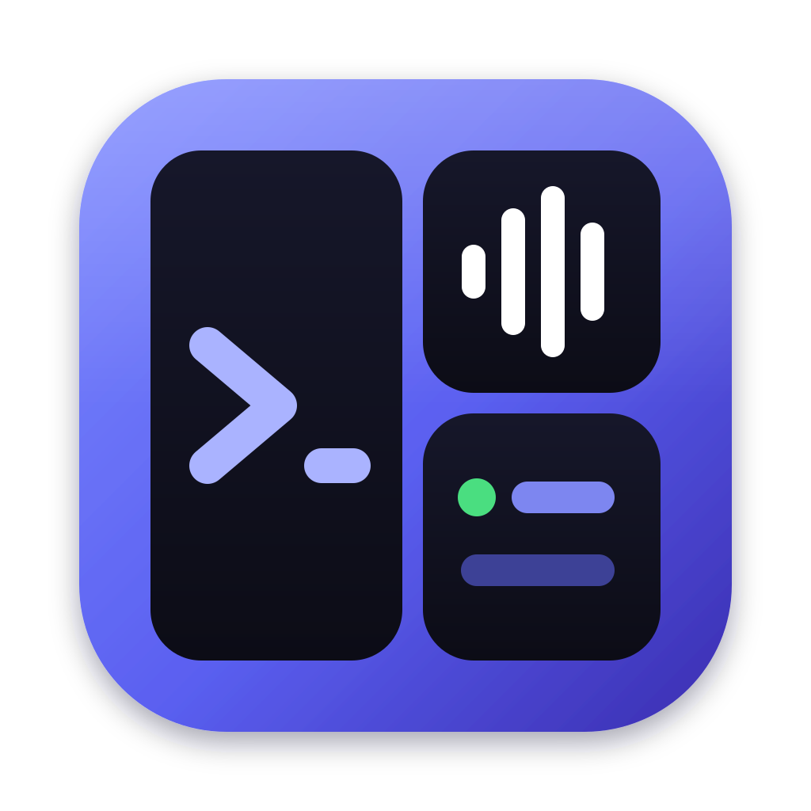
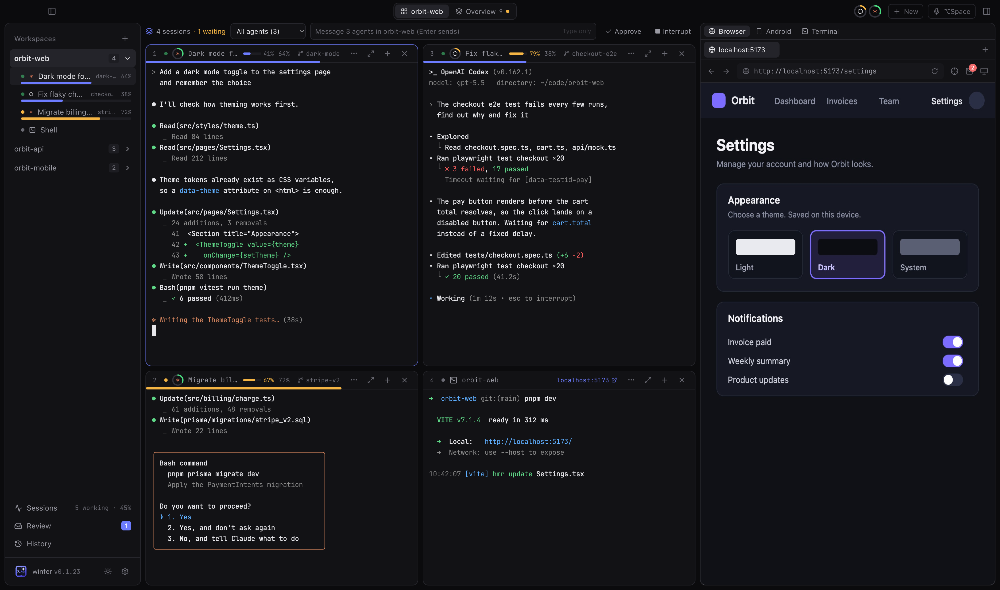
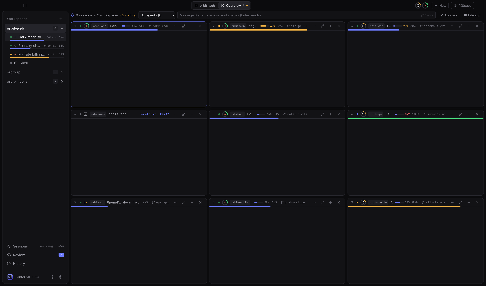
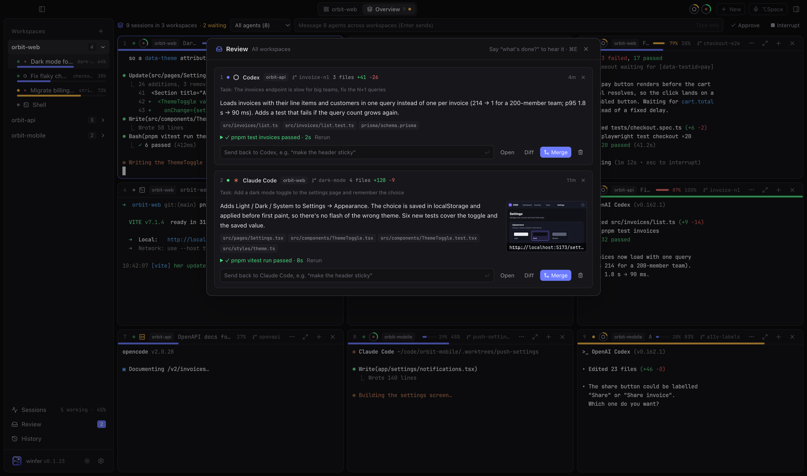
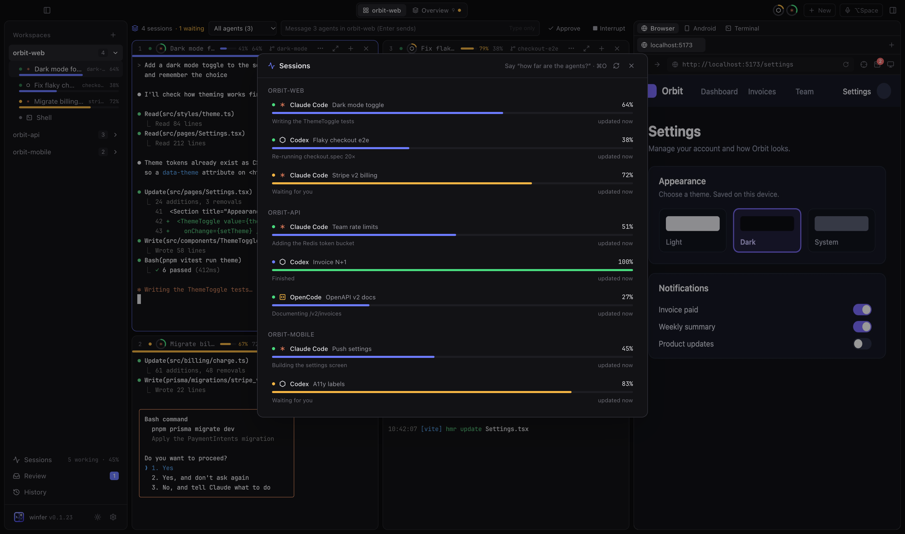
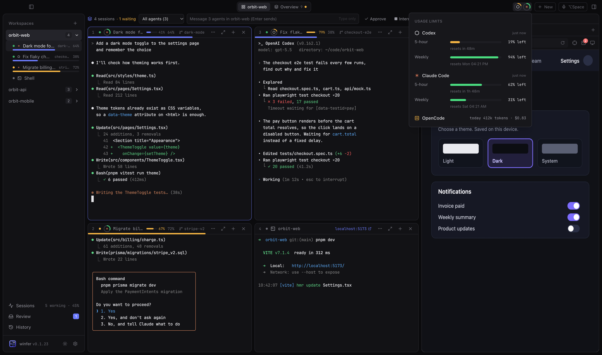
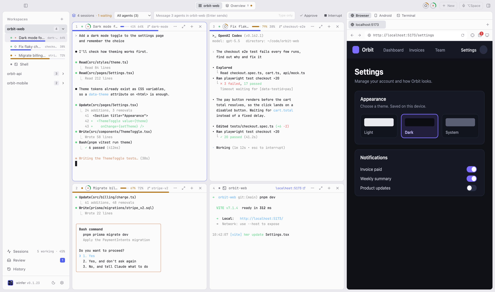

<p align="center">
  
</p>

<h1 align="center">winfer</h1>

<p align="center">
  Run a team of coding agents side by side — Claude Code, Codex, OpenCode and more —<br>
  each in its own git worktree, with a browser, review inbox and voice control built in.
</p>

<p align="center">
  <a href="https://github.com/RickyDane/winfer/releases/latest">Download for macOS and Windows</a>
</p>



## Why winfer

Coding agents are fast, but one at a time they leave you waiting. winfer lets you run several at
once without the chaos: every agent gets its own worktree and branch, you see at a glance which
ones are working, which need you and how far along they are, and finished work lands in a review
inbox where you merge it with one click.

## Every session, every workspace, one screen

The **Overview** tab tiles the sessions of all your workspaces together. Message, approve or
interrupt any of them — or all of them at once.



## Review finished work, then merge

When an agent is done, a card shows up with a summary of what changed, the files, a test run and
a screenshot of the running app. Merge it, send it back with a comment, or discard it. Every merge
is kept in a searchable **History**.



## Know how far along everything is

winfer estimates each agent's progress from its task and what it's doing, and shows it in the
sidebar, the pane headers and the **Sessions** view. Agents that wait for you are marked, and a
native notification can approve or decline right from the banner.



## Stay within your plan

Rings in the title bar show how much of each agent's usage limit is left (5-hour and weekly
windows), with reset times and a projection at your current pace. Each pane shows how full its
context window is. When one agent hits its limit, **Continue in Codex** hands the task over to
an agent that still has room — same worktree, with the task and its progress.



## Also in the box

- **Agents can use the browser.** The built-in Chromium is shared with Claude Code, Codex and
  OpenCode through Playwright MCP: they can open your app, click through it and take screenshots.
  Pick an element with the crosshair to hand it to an agent; send console errors with one click.
- **Android mirroring.** See and control a phone or emulator over adb, next to the browser.
- **Voice.** Hold <kbd>⌥ Space</kbd> and say "open two Claude panes and ask them to fix the
  login bug" — or dictate a prompt. Speech runs locally (whisper).
- **Worktrees without the bookkeeping.** Existing worktrees and branches show up in the sidebar
  with their age and whether they're merged; start an agent on any branch.
- **A terminal tab** next to the browser for quick commands, and plain shell panes anywhere.
- **Every shortcut can be changed**, light and dark mode, resizable everything.



## Install

Download the latest `.dmg` (macOS 11+, Apple Silicon and Intel) or the `.exe` / `.msi` installer (Windows 10+)
from [Releases](https://github.com/RickyDane/winfer/releases/latest). winfer starts the agent CLIs
you already have installed (`claude`, `codex`, `opencode`, …) — install and log in to them first.

## Build from source

Requirements: Node 20+, pnpm, Rust (stable) and the [Tauri prerequisites](https://tauri.app/start/prerequisites/).

```sh
pnpm install
pnpm tauri dev      # run the app
pnpm tauri build    # build an installer
pnpm test           # frontend tests
cd src-tauri && cargo test
```

`pnpm dev` alone runs the UI in a browser against a mock backend. The screenshots above come from
its showcase mode: start `pnpm dev`, then run `scripts/screenshots.sh`.

See [TESTING.md](TESTING.md) for the manual test checklist.
