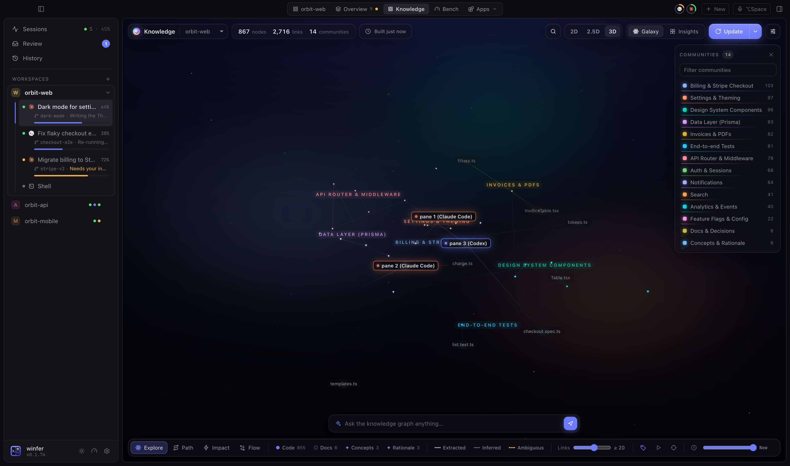
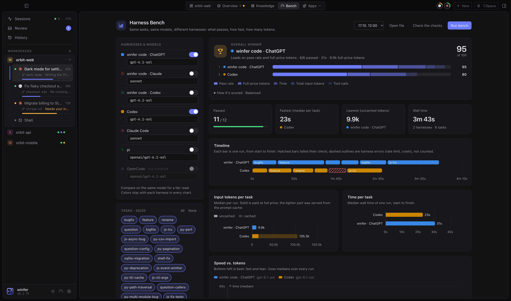

<p align="center">
  
</p>

<h1 align="center">winfer</h1>

<p align="center">
  Run a team of coding agents side by side — Claude Code, Codex, OpenCode and more —<br>
  each in its own git worktree, with a browser, review inbox and voice control built in.
</p>

<p align="center">
  <a href="https://github.com/RickyDane/winfer/releases/latest">Download for macOS and Windows</a>
</p>


## Why winfer

Coding agents are fast, but one at a time they leave you waiting. winfer lets you run several at
once without the chaos: every agent gets its own worktree and branch, you see at a glance which
ones are working, which need you and how far along they are, and finished work lands in a review
inbox where you merge it with one click.

## Every session, every workspace, one screen

The **Overview** tab tiles the sessions of all your workspaces together. Message, approve or
interrupt any of them — or all of them at once.


## Review finished work, then merge

When an agent is done, a card shows up with a summary of what changed, the files, a test run and
a screenshot of the running app. Merge it, send it back with a comment, or discard it. Every merge
is kept in a searchable **History**.

Cards warn before anything breaks: which branches conflict with the base or touch the same files as
another agent. **Merge all** puts them in a queue that merges one at a time, bringing in what landed
before and running the tests first; a branch that conflicts goes back to its agent to resolve. Each
card and merge also shows what the agents spent on it, and the Usage page breaks spend down by task.


## Know how far along everything is

winfer estimates each agent's progress from its task and what it's doing, and shows it in the
sidebar, the pane headers and the **Sessions** view. Agents that wait for you are marked, and a
native notification can approve or decline right from the banner.


## Stay within your plan

Rings in the title bar show how much of each agent's usage limit is left (5-hour and weekly
windows), with reset times and a projection at your current pace. Each pane shows how full its
context window is. When one agent hits its limit, **Continue in Codex** hands the task over to
an agent that still has room — same worktree, with the task and its progress.


## See your codebase the way the agents do

The **Knowledge** plugin turns each project into a knowledge graph you explore as a live
3D galaxy, a flat galaxy or a plain 2D map. Pick the engine per project:
[graphify](https://pypi.org/project/graphifyy/) (code, docs and concepts) or
[codegraph](https://github.com/colbymchenry/codegraph) (code only, exact calls and imports, fast to keep fresh). Ask it questions, trace paths and impact, replay call
flows step by step — and watch which parts of the code each agent is looking at right now. Agents
query the same graph with tools.



## Pick the best harness for the job

**winfer bench** runs winfer code, Codex, Claude Code, pi and OpenCode on the same tasks with the
models you pick, and compares pass rate, time, tokens and tool calls — with an overall winner, a
timeline of every run and charts per task. Tasks come in four suites: coding, understanding,
research and discipline (staying in scope, exact formats, ignoring planted instructions).



## Also in the box

- **Agents can use the browser.** The built-in Chromium is shared with Claude Code, Codex and
  OpenCode through Playwright MCP: they can open your app, click through it and take screenshots.
  Pick an element with the crosshair to hand it to an agent; send console errors with one click.
- **Android mirroring.** See and control a phone or emulator over adb, next to the browser.
- **Live voice.** Press <kbd>⌘ ⌥ V</kbd> and talk with winfer: "open two Claude panes and ask
  them to fix the login bug", "what is Codex doing?", "open the dev server and click Settings".
  OpenAI's realtime model answers aloud and drives panes, agents, the browser, files and plugins
  (needs an OpenAI API key).
- **Worktrees without the bookkeeping.** Existing worktrees and branches show up in the sidebar
  with their age and whether they're merged; start an agent on any branch.
- **A terminal tab** next to the browser for quick commands, and plain shell panes anywhere.
- **A plugin store** in Settings → Plugins: Databases, Task Board, Prompt Library, Secrets,
  Telegram, Screen Recorder, Cross-Project Knowledge and more — or [write your own](docs/plugins/README.md).
- **Every shortcut can be changed**, light and dark mode, resizable everything.


## Install

Download the latest `.dmg` (macOS 11+, Apple Silicon and Intel) or the `.exe` / `.msi` installer (Windows 10+)
from [Releases](https://github.com/RickyDane/winfer/releases/latest). winfer starts the agent CLIs
you already have installed (`claude`, `codex`, `opencode`, …) — install and log in to them first.

**Nebula channel** — every change on `main` is built right away as a pre-release (`vX.Y.Z-N`) on
[Releases](https://github.com/RickyDane/winfer/releases). Pick which updates you get under Settings (bottom
left): **Stable** only offers stable releases, **Nebula** every build, stable ones included. Installs start on
the channel of the build you downloaded.
Maintainers promote a Nebula build to stable with the **stable** workflow in Actions.

## Build from source

Requirements: Node 20+, pnpm, Rust (stable) and the [Tauri prerequisites](https://tauri.app/start/prerequisites/).

```sh
pnpm install
pnpm tauri dev      # run the app
pnpm tauri build    # build an installer
pnpm test           # frontend tests
cd src-tauri && cargo test
```

`pnpm dev` alone runs the UI in a browser against a mock backend. The screenshots above come from
its showcase mode (`?showcase=hero`, `overview`, `review`, `usage`, `sessions`, `light`, `knowledge`
or `bench`): start `pnpm dev`, then run `scripts/screenshots.sh` (or `scripts/screenshots.sh bench`
for one scene).

See [TESTING.md](TESTING.md) for the manual test checklist.
